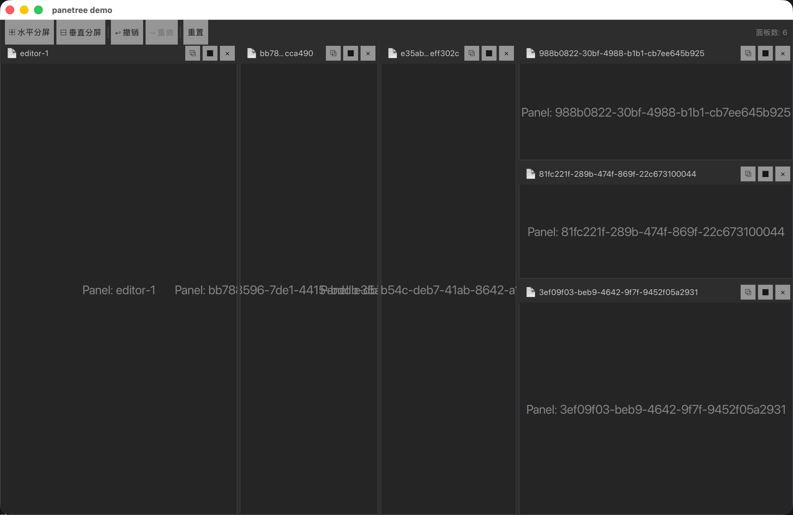

# panetree

递归分割面板的 QML / C++ 库。把任意 QML 内容嵌进可任意嵌套水平/竖直分屏的容器里，
带拖拽改尺寸、撤销/重做、持久化。



## 三个类

- **`QPaneTree::QPaneNode`** —— 树节点。Leaf 持 `viewId`，Split 持 orientation/ratio/first/second。
- **`QPaneTree::QPaneTreeModel`** —— 持根节点 + 所有 mutation API + undo/redo + 序列化。
- **`QPaneTree::QPaneTreeView`** —— QQuickItem 视图，递归渲染整棵树。

QML 类型名（去 namespace）：`QPaneNode` / `QPaneTreeModel` / `QPaneTreeView`。

## 用法

```qml
import PaneTree

QPaneTreeModel { id: paneTree; Component.onCompleted: reset("editor-1") }

QPaneTreeView {
    anchors.fill: parent
    model: paneTree

    leafDelegate: Component {
        MyEditor {
            // 通过 attached property 拿到本 leaf 的标识
            viewId: QPaneTreeView.viewId
            onClose:  paneTree.close(viewId)
            onSplitH: paneTree.split(viewId, Qt.Horizontal)
        }
    }

    // 可选：定制分割条样式
    handleDelegate: Component {
        Rectangle {
            implicitWidth:  QPaneTreeView.orientation === Qt.Horizontal ? 4 : parent.width
            implicitHeight: QPaneTreeView.orientation === Qt.Vertical   ? 4 : parent.height
            color: SplitHandle.hovered ? "#569cd6" : "#2d2d2d"
        }
    }

    // 可选：完全替换 SplitView（含 handle）
    // splitDelegate: Component { SplitView { ... } }
}
```

## leaf delegate 的生命周期（重要）

> **一个 `viewId` 一份 delegate 实例，活到这个 viewId 关掉为止。**

分割、关掉相邻格、进出最大化、`restoreState()` —— 这些都会改变树结构，但**不会**重建
已有 viewId 的 delegate。所以宿主可以放心把有状态的东西（编辑器缓冲区、终端会话、
远程桌面连接）直接放进 leaf delegate，不需要自己在外面搭一个"视图池"。

实例由 `QPaneTreeView` 按 viewId 缓存，停在一个隐藏的池子里，由当前渲染出来的插槽
reparent 过去。delegate 只在 `QPaneTreeModel::viewClosed` 时销毁。

```qml
// 宿主想直接够到某一格的内容：
const item = paneTreeView.leafItem("editor-3")
```

**1.1 之前不是这样**：delegate 长在递归渲染层里，而渲染层在树结构一变时整棵重建 ——
一次分割会把幸存那一格的 delegate 销毁重建。对编辑器 / 终端类宿主，那等于"分个屏，
正在跑的活就没了"。模型层其实早就把 viewId 当稳定身份在承诺（`setRoot()` 对两边都
存在的 viewId **不发** `viewClosed` + `viewCreated` 配对），渲染层此前跟它自相矛盾。

split delegate 不在这条承诺里：它不承载用户状态，树一变照常重建。

## 注入给 delegate 的 attached property

| 属性 | 类型 | 作用域 |
|---|---|---|
| `QPaneTreeView.node` | `QPaneNode*` | leaf + split |
| `QPaneTreeView.viewId` | `string` | leaf |
| `QPaneTreeView.nodeId` | `string` | leaf + split |
| `QPaneTreeView.isActive` | `bool` | leaf |
| `QPaneTreeView.orientation` | `int` | split + handle |
| `QPaneTreeView.ratio` | `qreal` | split |
| `QPaneTreeView.commitRatio()` | invokable | split (传 SplitView 引用) |

leaf 上那几个由 `QPaneTreeView` 按模型推（结构变化 / 活动格变化时刷新），**不是**绑在
渲染层的作用域上 —— 实例比渲染层活得长，绑过去的话渲染层一销毁绑定就悬空。
注意 `node`：分割时目标 leaf 会原地升级成 Split，同名 viewId 挂到一个**新建**的 leaf
节点上，所以 `node` 是会换对象的，而 `viewId` 不会。**要存就存 viewId。**

## 持久化

```qml
const state = paneTree.saveState()        // 返回 QVariantMap
paneTree.restoreState(state)              // 用 plist/JSON 等持久化
```

## 集成

```cmake
add_subdirectory(third_party/panetree)
target_link_libraries(yourapp PRIVATE panetree panetreeplugin)
```

QML 文件里 `import PaneTree`。
